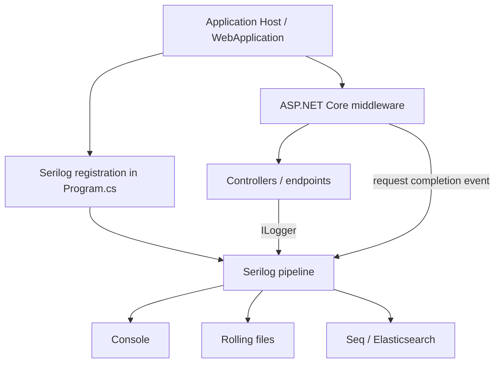

# ASP.NET Core integration and dependency injection

`Serilog.AspNetCore` routes ASP.NET Core's `Microsoft.Extensions.Logging.ILogger` events through Serilog. Application code can inject `ILogger<T>` and use the same sinks and level policy as framework events.

## Host, middleware, controllers, and destinations



The host builds dependency injection and configuration. `AddSerilog()` connects Microsoft logging to the Serilog pipeline. Middleware and controllers use injected logging interfaces; Serilog sends their events to configured destinations. Place request logging middleware before the endpoints it should measure.

## Minimal host setup

```csharp
using Serilog;

var builder = WebApplication.CreateBuilder(args);

builder.Services.AddSerilog((services, configuration) => configuration
    .ReadFrom.Configuration(builder.Configuration)
    .ReadFrom.Services(services)
    .Enrich.FromLogContext());

builder.Services.AddControllers();
var app = builder.Build();
app.MapControllers();
app.Run();
```

Install `Serilog.AspNetCore`, `Serilog.Settings.Configuration`, and the configured sink packages. Match the `Serilog.AspNetCore` major version to the target .NET/hosting generation as documented by the integration project. `ReadFrom.Services()` allows registered enrichers and related components to participate when supported. Use `ILogger<T>` through DI in application classes.

Reference: [Serilog.AspNetCore](https://github.com/serilog/serilog-aspnetcore).
