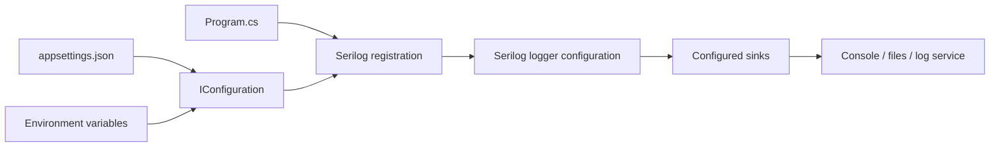

# Configuration basics

Serilog configuration has two main parts: the core logger and the optional external configuration source. Code configuration is type-safe and discoverable; JSON configuration can let operations teams tune levels or destinations without recompiling. Most applications use a small code bootstrap with most settings in configuration.

## Configuration flow



`Program.cs` creates the host and attaches Serilog. JSON and environment variables enter the .NET configuration system; `ReadFrom.Configuration()` reads the `Serilog` section. Sink configuration then routes accepted events. Precedence among configuration providers follows the host's provider order; environment variables commonly override JSON values.

## The essential rule: a sink is required

An empty logger configuration can accept calls but writes nowhere. Add at least one sink. Multiple sinks can be configured so the same event is written to separate destinations. Text-based sinks have output templates; structured sinks preserve fields in their own format.

```csharp
var logger = new LoggerConfiguration()
    .MinimumLevel.Information()
    .WriteTo.Console()
    .WriteTo.File("logs/app-.log", rollingInterval: RollingInterval.Day)
    .CreateLogger();
```

Packages: `Serilog`, `Serilog.Sinks.Console`, and `Serilog.Sinks.File`. The rolling filename pattern creates dated files; choose retention and storage policy deliberately. See [Code configuration](code.md), [appsettings.json](appsettings.md), and [Provided Sinks](https://github.com/serilog/serilog/wiki/Provided-Sinks).
