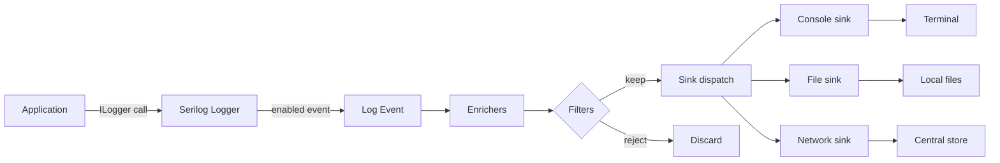
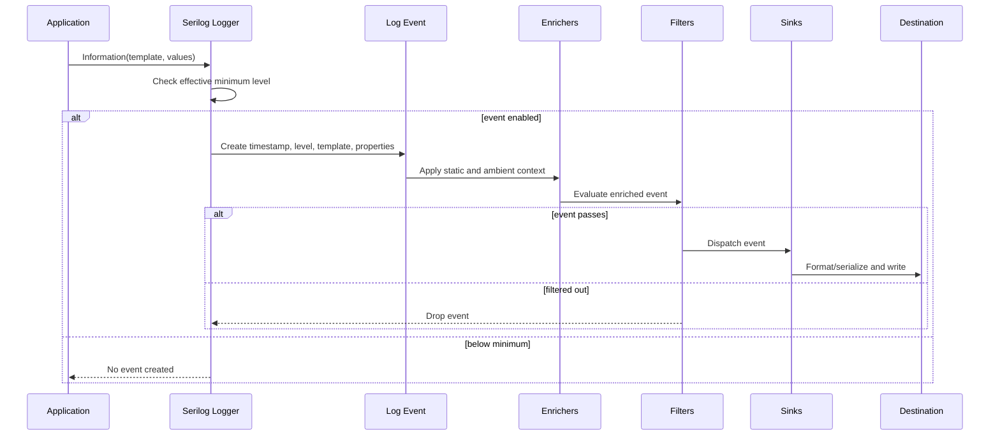

# Architecture and event lifecycle

## Logging event path

**Data flow:** the call supplies a level, template, values, and optionally an exception. The logger checks its minimum level before doing event work. An accepted call becomes a log event; enrichers attach ambient or static properties; filters decide whether it continues; sinks independently write it. Text formatting happens at text sinks, while structured sinks can preserve property types.

| Component | Responsibility |
|---|---|
| Application / `ILogger` | Expresses a diagnostic event without choosing its storage destination. |
| Serilog logger | Applies level rules and owns the configured pipeline. |
| Log event | Carries timestamp, level, template, bound properties, and exception. |
| Enricher | Adds consistent context such as service name or correlation ID. |
| Filter | Removes events that meet a configured condition. |
| Sink | Adapts and writes the event to a destination. |
| Destination | Stores or displays the resulting event for operations and investigation. |

## Event lifecycle detail

Filters and level thresholds are useful controls, but they are not substitutes for careful event design: avoid constructing expensive values unless a level is enabled, and avoid putting secrets into the event in the first place.

References: [Configuration Basics](https://github.com/serilog/serilog/wiki/Configuration-Basics), [Writing Log Events](https://github.com/serilog/serilog/wiki/Writing-Log-Events).
