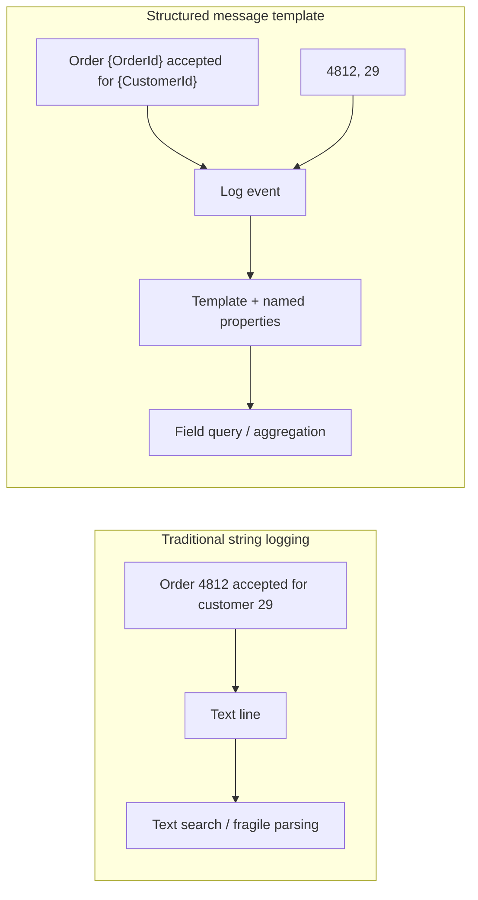

# What is Serilog?

Serilog is a .NET logging library designed around **log events**: timestamped records with a level, a message template, and named properties. It supports structured logging while still rendering readable text for people. Applications write through a logger; configured sinks send events to destinations such as a console, rolling files, or a log server.

## Why structured logging matters

A plain text line is convenient to read, but it is difficult to search reliably. With structured logging, `OrderId` remains a value that a log system can filter, group, or aggregate. A query such as `OrderId = 4812` is safer than searching for a substring that might occur in unrelated text.

```csharp
logger.Information("Order {OrderId} accepted for {CustomerId}", order.Id, customer.Id);
```

The template is stable while the values vary. A JSON-capable sink can retain `OrderId` and `CustomerId` as fields. A text sink can render the same event as a readable line.

## Traditional logging vs. structured logging



In the structured path, values are bound to named properties at the logging call. The event preserves the template and values separately; destination formatting can produce text or structured output. This differs from interpolating values into a string before calling the logger, which loses their original field boundaries.

## Serilog architecture overview

Serilog can be used directly or behind `Microsoft.Extensions.Logging.ILogger`. The abstraction lets application code depend on familiar .NET logging interfaces while Serilog provides the implementation and sink pipeline. See [Architecture and event lifecycle](architecture.md).

## Core vocabulary

- **Logger**: accepts events and holds pipeline configuration.
- **Log event**: timestamp, level, message template, properties, and optional exception.
- **Enricher**: adds properties such as application, machine, or request identifiers.
- **Filter**: excludes events based on predicates.
- **Sink**: receives events and writes them to a destination.
- **Message template**: stable text with named placeholders that bind event properties.

References: [Serilog repository](https://github.com/serilog/serilog), [Configuration Basics](https://github.com/serilog/serilog/wiki/Configuration-Basics), [Writing Log Events](https://github.com/serilog/serilog/wiki/Writing-Log-Events).
