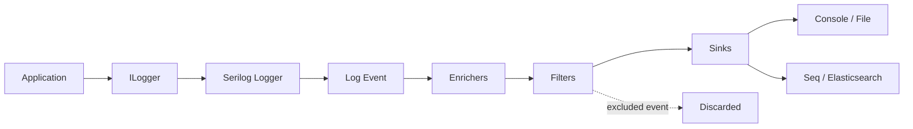

# Serilog in .NET

**A practical guide to structured logging, configuration, and production operations.**

Serilog is a logging library for .NET that records events as structured data. This handbook explains how to create useful events, route them through a logging pipeline, and operate that pipeline safely in real applications.

## Who this is for

This guide is for .NET developers who are new to Serilog, teams standardizing application logging, and experienced engineers designing observability and production logging practices. Examples target modern .NET applications and ASP.NET Core; package versions should be selected to match the target framework.

## What you will learn

- Why message templates and named properties are more useful than preformatted strings.
- How loggers, events, enrichers, filters, and sinks fit together.
- How to configure Serilog in code and with `appsettings.json`.
- How to integrate with ASP.NET Core, add request context, and emit one request completion event.
- How to select sinks, send events to centralized systems, and manage cost, security, retention, and reliability.

## How to use the handbook

Start with [What is Serilog?](foundations/what-is-serilog.md), then follow Foundations to learn the event model. Configuration and ASP.NET Core chapters show how to apply it in an application. Pipeline and Production explain where events go and how to operate logging responsibly. The sidebar groups topics in that order; search is available from the header.

## Event pipeline at a glance

The application calls `ILogger` (or Serilog's `ILogger`); the configured logger decides whether an event is enabled, creates a structured event, adds contextual properties, applies filters, then dispatches it to each configured sink. Each sink adapts the event to a destination. See [Architecture and event lifecycle](foundations/architecture.md) for component responsibilities and detailed flow.

## Documentation sources

This handbook paraphrases and expands the official Serilog material, with original references linked throughout. It is a team learning resource, not a replacement for package-specific documentation: sink behavior and supported options vary by package and version. See [References](references.md) for canonical links.
