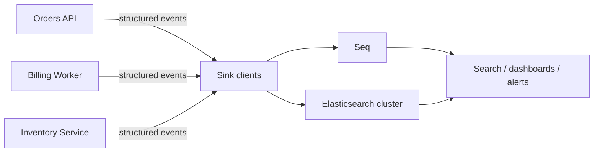

# Seq and Elasticsearch

Centralized systems collect events from multiple application instances so engineers can search across services and deployments. Select a sink package whose supported endpoint and version match the deployed service. Configure endpoints and credentials outside source control.

## Seq

Use `Serilog.Sinks.Seq` to send structured events to Seq:

```csharp
var logger = new LoggerConfiguration()
    .Enrich.WithProperty("Application", "Orders.Api")
    .WriteTo.Seq("http://localhost:5341")
    .CreateLogger();
```

The package is [Serilog.Sinks.Seq](https://www.nuget.org/packages/Serilog.Sinks.Seq). For production, configure the server URL and any API key via protected configuration; do not commit credentials. Review the sink's batching and failure behavior in its documentation.

## Elasticsearch

Elasticsearch integrations have multiple community packages and APIs that change across generations. Choose a currently maintained sink compatible with your Elasticsearch version and follow that package's current setup instructions. Do not assume configuration options are interchangeable among similarly named packages. The [provided sinks catalog](https://github.com/serilog/serilog/wiki/Provided-Sinks) links available projects. Validate index naming, mappings, retention lifecycle, authentication, TLS, retry behavior, and compatibility before deployment.

## Multiple applications to centralized logging



Each application adds service identity and environment fields before sending events. Sink clients transport events to the selected central backend; operators query or alert there. The diagram represents alternative destinations as well as a possible dual-write design. Dual-writing increases bandwidth and storage and should be an explicit decision. Centralize with authentication and network controls; preserve application availability if the logging endpoint is unavailable.
