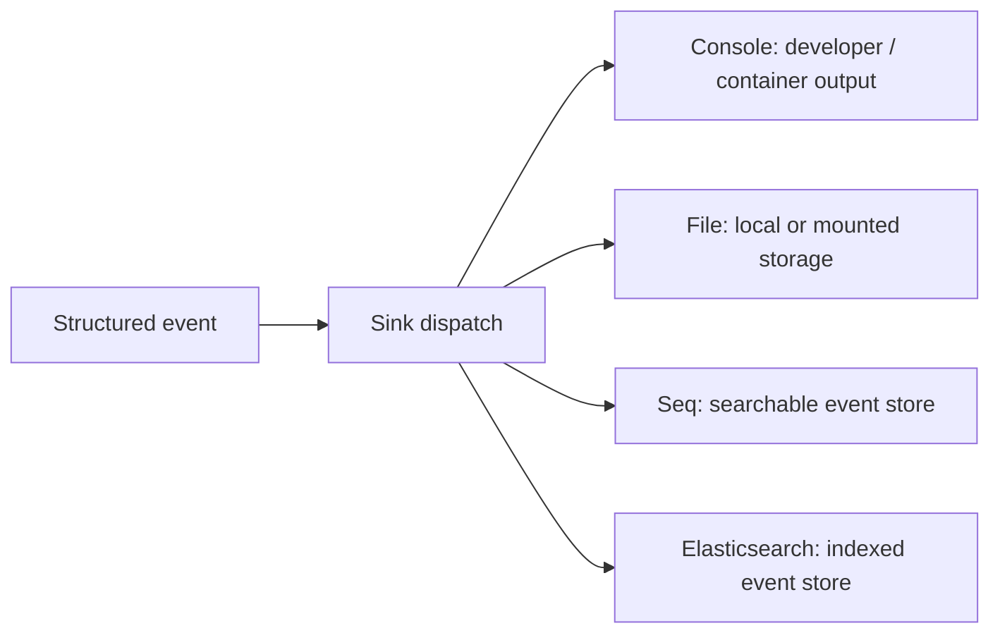

# Sinks: destinations for events

A sink receives a Serilog event and writes it to a destination. Sinks are separate NuGet packages and differ in formatting, batching, durability, backpressure behavior, and configuration. One logger can write to multiple sinks.

The event enters each configured sink. Console is convenient for local development and container platforms that collect stdout. File is useful where local files are part of an operational plan. Seq and Elasticsearch provide centralized search and querying when deployed and operated separately. Multiple sinks duplicate data and cost; configure only destinations with an intended consumer.

## Sink selection

Check the sink's official repository for supported framework versions, structured property behavior, batching, retry policy, and buffering. Many listed sinks are maintained by community contributors, not the Serilog core team. Start with the [provided sink catalog](https://github.com/serilog/serilog/wiki/Provided-Sinks) and the package's NuGet page.
