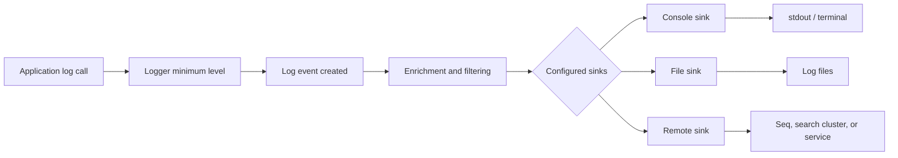

# Sinks: writing events to destinations

This chapter expands the official [Provided Sinks](https://github.com/serilog/serilog/wiki/Provided-Sinks) catalog. A sink receives Serilog log events and writes them to a destination, usually in a text or structured representation. Sink packages are distributed separately through NuGet; adding a package makes its sink available, and `WriteTo` adds it to the logger pipeline.

## How a sink participates in the pipeline



The logger decides if an event is enabled before sink dispatch. Each configured sink receives events that pass its own restrictions and adapts the event to its output. A text sink renders a line using a text template; a structured sink can encode the template and named property values separately. A sink may also batch writes or buffer them, so shutdown and failure behavior depend on its package.

## One event, multiple sinks

```csharp
var logger = new LoggerConfiguration()
    .MinimumLevel.Debug()
    .WriteTo.File("logs/all-.log", rollingInterval: RollingInterval.Day)
    .WriteTo.Console(restrictedToMinimumLevel: LogEventLevel.Information)
    .CreateLogger();
```

This sends Debug and higher events to the file, while the console receives Information and above. The logger-level minimum is the first gate: a sink cannot receive events rejected before their creation. A sink-level minimum can only make that sink more restrictive.

## Categories in the official catalog

The official catalog lists packages maintained by Serilog contributors and the wider community. Entries span console and file output, cloud platforms, databases, diagnostics, messaging systems, and log servers. The table below names common choices; it is not exhaustive and package availability or maintenance status can change.

| Destination or use | Package/reference |
|---|---|
| Console | [Serilog.Sinks.Console](https://www.nuget.org/packages/Serilog.Sinks.Console) |
| Rolling text files | [Serilog.Sinks.File](https://www.nuget.org/packages/Serilog.Sinks.File) |
| Seq | [Serilog.Sinks.Seq](https://www.nuget.org/packages/Serilog.Sinks.Seq) |
| Elasticsearch | Check the current package options in the [official catalog](https://github.com/serilog/serilog/wiki/Provided-Sinks); package APIs vary. |
| Async wrapper | See the [official catalog](https://github.com/serilog/serilog/wiki/Provided-Sinks) and its package README for buffering and shutdown behavior. |
| Other systems | Browse the live [Provided Sinks](https://github.com/serilog/serilog/wiki/Provided-Sinks) list and NuGet's [Serilog tag](https://www.nuget.org/packages?q=Tags%3Aserilog). |

## Choose a sink by operational behavior

Before selecting a sink, check its current README and release notes for supported .NET targets, structured serialization, batching, retries, buffering limits, backpressure, authentication, and disposal behavior. Consider where data is stored, how it is searched, who can access it, what happens when the destination is unavailable, and how retention is applied. Do not assume packages in the catalog have identical support or are maintained by the Serilog core team.

References: [Provided Sinks](https://github.com/serilog/serilog/wiki/Provided-Sinks), [Configuration Basics](https://github.com/serilog/serilog/wiki/Configuration-Basics).
